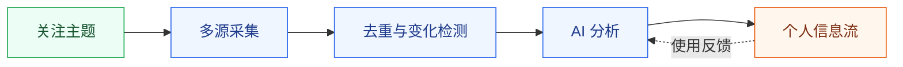

# SignalDock


SignalDock 是一个面向个人使用的信息收集与持续监测平台。设置关注主题后，它会从常用信息平台定时收集公开内容，合并同一事件，识别内容变化，再通过 AI 或本地规则完成初步筛选。

## 功能特性

- 管理关注主题、关键词、别名和排除词
- 为不同主题设置来源范围、采集频率和通知级别
- 聚合百度、B 站、微博、知乎、掘金和 GitHub 公开信息
- 清理 URL 跟踪参数，按内容指纹去重并合并同一事件
- 保存历史快照，识别首次发现和内容更新
- 通过 OpenAI 兼容接口生成摘要、相关性和重要度评分
- 支持有限并发、超时、指数退避重试和 AI 调用记录
- 无 API Key 时自动使用本地规则完成分析
- 按来源、未读、相关性和重要程度筛选与排序
- 根据“有用、无关、重复”反馈调整个性化排序
- 支持定时采集、Socket.io 实时状态和每日/每周邮件摘要
- 提供事件库、采集任务、来源健康和通知渠道页面
- 支持飞书、企业微信、钉钉和通用 Webhook
- 支持 JSON/CSV 导出以及完整备份恢复

## 工作流程



## 信息来源

- 百度
- B 站
- 微博
- 知乎
- 掘金
- GitHub
- 本地测试数据

## 技术栈

- **后端：** Node.js、TypeScript、Express 5
- **前端：** React 19、Vite、Socket.io Client、Lucide
- **数据库：** SQLite（Node.js 内置 `node:sqlite`）
- **AI：** OpenAI 兼容接口，默认使用硅基流动
- **定时任务：** node-cron
- **实时通信和通知：** Socket.io、Nodemailer
- **测试：** Vitest

## 快速开始

### 环境要求

- Node.js 24+
- npm 10+
- Git

### 安装和启动

克隆项目并安装依赖：

```powershell
git clone https://github.com/koucxz/ai-information-collector.git
cd ai-information-collector
Copy-Item .env.example server/.env
cd server; npm install
cd ../client; npm install
```

分别启动后端和前端：

```powershell
cd server
npm install
npm run dev
```

```powershell
cd client
npm install
npm run dev
```

浏览器访问 `http://localhost:5173`。不配置外部密钥也可以使用本地测试数据和本地分析规则。

### 环境变量

常用配置如下，完整配置见 [.env.example](.env.example)：

```env
AI_BASE_URL=https://api.siliconflow.cn/v1
AI_API_KEY=
AI_MODEL=Qwen/Qwen3-8B
GITHUB_TOKEN=
COLLECTION_SCHEDULE_ENABLED=false
COLLECTION_CRON=0 */2 * * *
```

开启定时采集或邮件摘要前，请先在 `.env` 中补全相应配置。

## Docker

```powershell
docker compose up --build -d
```

启动后访问 `http://localhost:8080`，SQLite 数据保存在 Docker volume 中。

## 常用接口

| 接口 | 说明 |
| --- | --- |
| `GET /api/health` | 服务状态 |
| `GET /api/topics` | 关注主题 |
| `GET /api/collect/sources` | 可用信息源 |
| `POST /api/collect/run` | 执行完整采集流程 |
| `GET /api/information` | 信息流与筛选 |
| `PUT /api/information/:id/feedback` | 提交使用反馈 |
| `GET /api/notifications/digest` | 预览周期摘要 |
| `GET /api/events` | 事件聚合列表 |
| `GET /api/collect/runs` | 采集任务记录 |
| `GET /api/collect/health` | 来源健康统计 |
| `GET /api/data/export?format=json` | 导出 JSON 数据 |
| `GET /api/data/export?format=csv` | 导出信息 CSV |
| `GET /api/data/backup` | 下载完整备份 |
| `POST /api/data/restore` | 恢复完整备份 |
| `GET /api/notifications/channels` | 通知渠道列表 |
| `POST /api/notifications/channels/:id/test` | 发送测试通知 |

## 贡献

欢迎提交 Issue 和 Pull Request。提交前请确认：

- 功能有明确的使用场景；
- 外部请求包含超时和失败处理；
- 不提交 API Key、Cookie 或其他敏感信息；
- 相关测试和构建命令能够通过。

## 许可证

[MIT](LICENSE)
