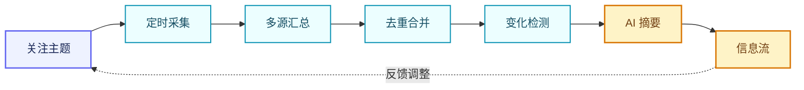

# SignalDock


一个面向个人使用的国内信息收集与持续监测平台。

SignalDock 按照用户设置的关注主题，从百度、B 站、微博、知乎、掘金和 GitHub 收集公开信息，完成去重、事件合并、变化检测和 AI 摘要，并提供可追溯的信息流。

## 功能特性

- 关注主题、关键词、别名和排除词管理
- 主题和关键词的新增、编辑、启停与删除
- 国内主要信息平台聚合
- GitHub 项目、Release 和 Issue 动态收集
- URL、标题和内容指纹去重
- 同一事件的多来源合并
- 历史快照和新内容、内容更新检测
- AI 相关性判断、重要程度分类和摘要生成
- 来源、时间、相关性和重要程度筛选
- 未读状态、历史回看和用户反馈
- 前后端健康检查和本地服务连接状态
- 可选的实时推送、邮件提醒和周期性摘要

## 工作流程



## 信息来源

- 百度
- B 站
- 微博
- 知乎
- 掘金
- GitHub
- 本地测试数据

各来源通过独立适配器接入，统一转换为内部信息结构。单个来源不可用时，不影响其他来源继续采集。

## 技术栈

- **后端：** Node.js、TypeScript、Express 5
- **前端：** React 19、Vite、Tailwind CSS
- **数据库：** SQLite（Node.js 内置 `node:sqlite`）
- **AI：** OpenAI 兼容接口，默认使用硅基流动
- **定时任务：** node-cron
- **实时通信和通知：** Socket.io、Nodemailer
- **测试：** Vitest

## 快速开始

### 环境要求

- Node.js 20+
- npm 10+
- Git

### 安装和启动

项目当前处于开发阶段，基础前后端工程已经可以启动，分别在两个终端运行：

```powershell
cd server
npm install
npm run dev
```

```powershell
cd client
npm install
npm run dev
```

### 配置环境变量

复制环境变量模板：

```powershell
Copy-Item .env.example .env
```

常用配置：

```env
AI_BASE_URL=https://api.siliconflow.cn/v1
AI_API_KEY=
AI_MODEL=Qwen/Qwen3-8B
GITHUB_TOKEN=
```

`.env` 只用于本地配置，不要提交到 Git。

## 开发路线

- [x] 初始化 Express 和 React 应用
- [x] 增加健康检查、开发环境代理、CORS 和基础限流
- [x] 实现关注主题和关键词管理
- [x] 建立 SQLite 数据模型和本地持久化
- [ ] 接入百度、B 站、微博、知乎和掘金
- [ ] 实现 URL、内容去重和事件合并
- [ ] 增加历史快照和变化检测
- [ ] 接入 GitHub 项目、Release 和 Issue
- [ ] 增加 AI 结构化分析和无密钥降级
- [ ] 完成信息流、筛选、排序、分页和未读状态
- [ ] 增加用户反馈和个性化排序
- [ ] 增加定时采集、实时推送、邮件通知和变化摘要
- [ ] 增加 CI、安全检查和部署配置

## 贡献

欢迎提交 Issue 和 Pull Request。提交前请确认：

- 功能有明确的使用场景；
- 外部请求包含超时和失败处理；
- 不提交 API Key、Cookie 或其他敏感信息；
- 相关测试和构建命令能够通过。

## 许可证

[MIT](LICENSE)
